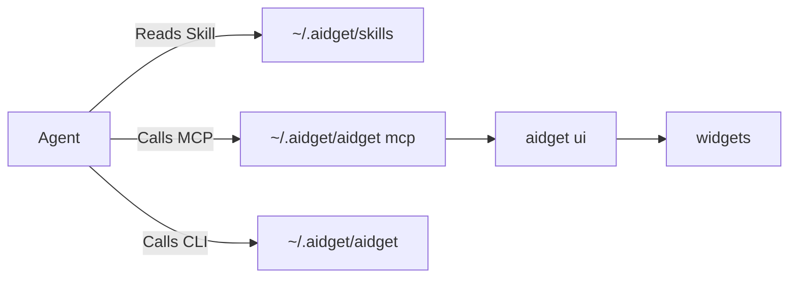

<!-- prettier-ignore -->
<div align="center">


# aidget

**Hand desktop creativity over to your AI agent**

[](https://github.com/aidget-ai/aidget/actions/workflows/check.yml)
[](https://github.com/aidget-ai/aidget/releases/latest)
[](https://www.rust-lang.org/)
[](https://tauri.app/)
[](https://modelcontextprotocol.io/)
[](LICENSE)

[Quick start](#quick-start) | [Cross-platform support](#cross-platform-support) | [Development](#development) | [Data directory](#data-directory) | [Permission controls](#permission-controls)<br>
English | [简体中文](README.zh-CN.md)


</div>

## Is aidget for you?

If your desktop feels lifeless and you already use a desktop agent such as ChatGPT, Claude, or Grok Bot, aidget can help your agent bring it to life.

Connect aidget to your agent, describe your ideas in natural language, and give your desktop a fresh look.

Some typical scenarios:

- **Sticky notes.** Ask your agent to create a personalized sticky note on the desktop and keep track of the day's tasks.
- **Weather widget.** Ask your agent to recreate the macOS weather widget with a live forecast.
- **Desktop pet.** Let your agent look after a digital pet and watch what it does.
- **Anniversary card.** Ask your agent to create a card for an important date so you never miss it.
- **Stock tracker.** Ask your agent to display the stocks you follow so you never miss a market update.

More ideas are waiting to be discovered!

## Cross-platform support

| Platform | Window / bridge | Capabilities and notes |
| --- | --- | --- |
| macOS 12+ | WKWebView / Unix socket | Screenshot, CoreLocation, and native glass material. |
| Windows x64 | WebView2 / named pipe | Screenshot and WinRT geolocation; use HTTPS for network requests made by scripts. |
| Linux x64 | WebKitGTK / Unix socket | Screenshot and GeoClue; under Wayland, positioning is controlled by the compositor. |

## Quick start

### 1. Install

Download and launch the build for your operating system from [GitHub Releases](https://github.com/aidget-ai/aidget/releases/latest).

> ⚠️ macOS and Windows packages are currently unsigned and may trigger Gatekeeper or SmartScreen warnings. Builds downloaded from GitHub Releases are the official builds.

Launching aidget opens the main window; you can also access it from the system tray. On first launch, aidget places a welcome widget on the desktop, so keep an eye out.

### 2. Connect an agent

> aidget detects common local agent applications. Any MCP-compatible client can also connect manually.

1. Open the **MCP & Skills** page.
2. Click the icons to connect **MCP Service** and **Agent Skill** for detected agents. Installing both is recommended.
3. If your agent does not detect the MCP server or the `aidget` Skill, restart it to reload the configuration.

### 3. Ask your agent to create a widget

Return to the agent chat you normally use and describe what you want, for example:

```text
/aidget Create an Ace of Hearts playing card as a desktop widget.
```

Or a scheduled task:

```text
/aidget Create a stock-tracking widget and check the latest Apple stock details every 5 minutes.
```

## Community widgets

Install community widgets that have passed security review from the **Community Widgets** panel.

Community widgets are maintained in [aidget-ai/widgets](https://github.com/aidget-ai/widgets). Visit that repository to learn how to contribute.

## Development

### How it works



### Requirements

- Rust 1.92 or newer
- Node.js 22.18+ (22.x) or 24.11+ (24.x)
- pnpm 12
- Tauri 2 platform prerequisites
- Linux: `libwebkit2gtk-4.1-dev`, `libayatana-appindicator3-dev`, and `librsvg2-dev`

### Run locally

```bash
git clone https://github.com/aidget-ai/aidget.git && cd aidget
pnpm install
pnpm dev
```

> To run development, tests, or a portable setup against an isolated directory, point `AIDGET_HOME` at a throwaway path:
>
> `AIDGET_HOME=/tmp/aidget-dev pnpm dev`

### Build

```bash
pnpm build             # production release bundle
pnpm build:debug       # debug app bundle
```

### Checks

```bash
pnpm check
pnpm test
cargo fmt --check
AIDGET_CHECK_TARGET=1 cargo check --lib
cargo test
```

### MCP service

| Tool | Purpose |
| --- | --- |
| `aidget_list` | List widgets, revisions, board revision, positions, broken entries, and display names. |
| `aidget_get` | Read one widget's metadata, HTML, CSS, `agents.md`, and current position. |
| `aidget_create` | Create a widget with HTML, CSS, permissions, and author guidance. |
| `aidget_update` | Replace files or metadata using revision compare-and-swap. |
| `aidget_patch` | Atomically replace the inner HTML of one or more `data-aidget-region` targets. |
| `aidget_move` | Move or resize with board revision CAS when the user asks. |
| `aidget_screenshot` | Capture the rendered widget as PNG and wait briefly for readiness. |
| `aidget_delete` | Move a widget to the trash. |
| `aidget_guide` | Read the complete Markdown authoring guide. |

### CLI

```text
aidget ui [--background]
aidget mcp
aidget widget list|show|create|update|patch|delete
aidget board show|move
aidget displays
aidget screenshot <id> [--scale N] [--out FILE]
aidget doctor
aidget guide
aidget community list --json
aidget community install @aidget-community/<id> --json
```

## Data directory

The default data root is `~/.aidget`.

```text
~/.aidget
├── aidget                    # stable CLI entry (aidget.cmd on Windows)
├── board.json                # widget positions and sizes
├── settings.toml             # application settings
├── widgets/
│   └── <id>/
│       ├── package.json      # optional npm package metadata (for publishing to npm)
│       ├── config.json       # title, platform/size, permissions, network and revision
│       ├── index.html        # widget structure
│       ├── style.css         # appearance, size, and layout styles
│       ├── agents.md         # guidance for future agents
│       └── assets/           # images, fonts, and other local assets
├── state/
│   ├── screenshots/          # widget screenshots
│   ├── storage/
│   │   └── <id>.json         # persistent widget data
│   └── widgets.json          # widget state
├── skills/
│   └── aidget/
│       └── SKILL.md          # the Skill distributed to agents
└── trash/                    # archived widgets
```

## Permission controls

aidget includes a permission model to improve runtime security.

### Permissions

Declare the permissions a widget needs in its `config.json` using `permissions`. The default is an empty list, granting no capabilities.

```
{
  "permissions": [
    "script",
    "storage",
    ...
  ]
}
```

- `script`: allows package-local scripts and inline `<script>` blocks already present in the served HTML. Inline blocks are authorized by content hashes. Remote scripts, `eval`, `new Function`, inline event attributes and `javascript:` URLs are blocked; use `addEventListener` for events. Without this permission, CSP blocks widget scripts. Widgets remain in a sandbox without same-origin access and cannot read other widgets' files or control the main window. Nested pages, objects and workers are always blocked.
- `storage`: provides local storage isolated per widget, with a 256 KB limit.
- `location`: lets a widget request the operating system's location service when it needs location information.

## Network permissions

Declare the exact HTTPS origins a widget can access in its `config.json` using `network`. The default empty list blocks network access. Grants cover API requests, images, styles, fonts and media; they never authorize remote JavaScript.

```
{
  "network": [
    "https://example.com"
  ]
}
```

### Security statement

aidget does not store model credentials, and prompts, replies and model keys do not pass through aidget (except for proactively configured GitHub access tokens).

See [SECURITY.md](SECURITY.md) for the vulnerability reporting process.

## License

[MIT License](LICENSE)
