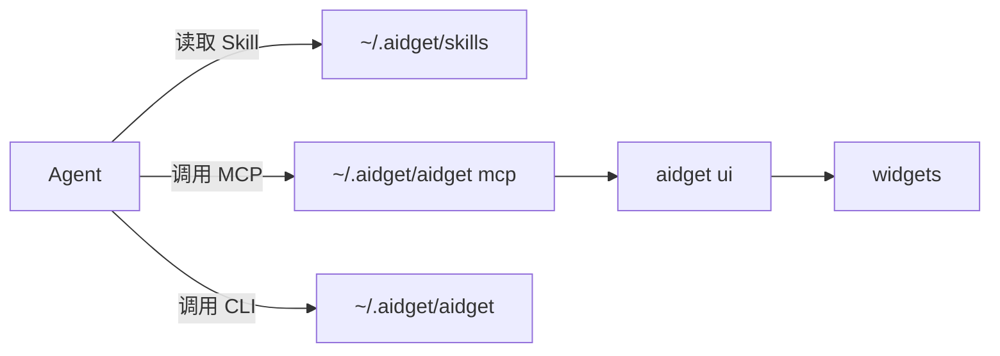

<!-- prettier-ignore -->
<div align="center">


# aidget

**把桌面创意交给 AI Agent**

[](https://github.com/aidget-ai/aidget/actions/workflows/check.yml)
[](https://github.com/aidget-ai/aidget/releases/latest)
[](https://www.rust-lang.org/)
[](https://tauri.app/)
[](https://modelcontextprotocol.io/)
[](LICENSE)

[快速开始](#快速开始) | [跨平台支持](#跨平台支持) | [开发](#开发) | [数据目录](#数据目录) | [权限管控](#权限管控)<br>
[English](README.md) | 简体中文


</div>

## aidget 适合你吗？

如果你的桌面死气沉沉，又恰好在使用 ChatGPT、Claude、Grok Bot 这样的桌面 Agent，那么 aidget 可以帮助你的 Agent 玩转桌面。

将 aidget 接入 Agent，用自然语言描述需求和创意，让桌面焕然一新。

一些典型场景：

- **便签纸**：让 Agent 在桌面创建个性化便签纸，记下每天的待办任务。
- **天气卡片**：让 Agent 复刻 macOS 天气小组件，实时展示当下天气预报。
- **桌面宠物**：让 Agent 照料你的电子宠物，观察它的一举一动。
- **纪念日卡**：让 Agent 创建一个纪念日卡片，记住重要的日子。
- **股市跟踪**：让 Agent 展示当前关注的股市信息，不错过任何交易时机。

更多创意待你发现！

## 跨平台支持

| 平台 | 窗口 / 桥接 | 能力与说明 |
| --- | --- | --- |
| macOS 12+ | WKWebView / Unix socket | 支持截图、CoreLocation 和原生 glass 材质。 |
| Windows x64 | WebView2 / 命名管道 | 支持截图和 WinRT 定位；脚本发起网络请求时使用 HTTPS。 |
| Linux x64 | WebKitGTK / Unix socket | 支持截图和 GeoClue；Wayland 下位置由合成器控制。 |

## 快速开始

### 1. 安装

从 [GitHub Releases](https://github.com/aidget-ai/aidget/releases/latest) 下载并启动适用于你操作系统的版本。

> ⚠️ macOS 和 Windows 安装包目前没有签名，可能触发 Gatekeeper 或 SmartScreen 提示，从 GitHub 渠道下载请放心安装。

启动 aidget 会打开主窗口，也可以从系统托盘访问 aidget，首次打开会在桌面放置一个欢迎卡片，请留意。

### 2. 接入 Agent

> aidget 会检测本机已安装的常见 Agent 应用程序，任何支持 MCP 的客户端也可以手动接入。

1. 进入 **MCP 与技能** 页面。
2. 点击右侧图标为检测到的 Agent 接入「MCP 服务」和「Agent Skill」，建议同时接入。
3. 如果 Agent 没有检测到 MCP 或是 `aidget` Skill，重启 Agent 让它重新加载配置。

### 3. 让 Agent 创建第一个小组件

回到你熟悉的 Agent 对话框，用自然语言提出需求创意，比如：

```text
/aidget 在桌面放一张红桃 A 扑克牌卡片
```

或者一个定时任务：

```text
/aidget 创建一个股票走势跟踪卡片，每隔 5 分钟监控当前 Apple 股票详情。
```

## 社区组件

可通过「社区组件」面板安装经过安全审查的社区组件。

社区组件维护在 [aidget-ai/widgets](https://github.com/aidget-ai/widgets)，如想贡献组件请前往该仓库查看。

## 开发

### 工作原理



### 环境要求

- Rust 1.92 或更高版本
- Node.js 22.18+（22.x）或 24.11+（24.x）
- pnpm 12
- Tauri 2 对应平台的构建依赖
- Linux：`libwebkit2gtk-4.1-dev`、`libayatana-appindicator3-dev` 和 `librsvg2-dev`

### 本地运行

```bash
git clone https://github.com/aidget-ai/aidget.git && cd aidget
pnpm install
pnpm dev
```

> 开发、测试或便携运行时，可以通过 `AIDGET_HOME` 环境变量指向隔离目录：
>
> AIDGET_HOME=/tmp/aidget-dev pnpm dev

### 构建

```bash
pnpm build             # 生成 release 正式包
pnpm build:debug       # 生成 debug 应用包
```

### 检查

```bash
pnpm check
pnpm test
cargo fmt --check
AIDGET_CHECK_TARGET=1 cargo check --lib
cargo test
```

### MCP 服务

| 工具                | 用途                                                       |
|---------------------|------------------------------------------------------------|
| `aidget_list`       | 列出小组件、revision、看板 revision、位置、损坏项和显示器名称。 |
| `aidget_get`        | 读取单个小组件的元数据、HTML、CSS、`agents.md` 和当前位置。    |
| `aidget_create`     | 创建包含 HTML、CSS、权限和作者说明的小组件。                  |
| `aidget_update`     | 基于 revision CAS 整体替换文件或元数据。                    |
| `aidget_patch`      | 原子替换一个或多个 `data-aidget-region` 的内部 HTML。       |
| `aidget_move`       | 在用户要求时以 boardRevision CAS 移动或缩放小组件。         |
| `aidget_screenshot` | 将渲染后的小组件截为 PNG，并等待页面就绪。                   |
| `aidget_delete`     | 将小组件移动到回收站。                                      |
| `aidget_guide`      | 读取完整的 Markdown 创作规范。                              |

### CLI 程序

```text
aidget ui [--background]
aidget mcp
aidget widget list|show|create|update|patch|delete
aidget board show|move
aidget displays
aidget screenshot <id> [--scale N] [--out FILE]
aidget doctor
aidget guide
aidget community list --json
aidget community install @aidget-community/<id> --json
```

## 数据目录

默认数据根目录是 `~/.aidget`（Windows 为 `C:\Users\<user>\.aidget`）。

```text
~/.aidget
├── aidget                    # CLI 入口（Windows 为 aidget.cmd）
├── board.json                # 卡片位置和尺寸
├── settings.toml             # 主程序配置
├── run/                      # 运行时 IPC 端点（macOS/Linux 使用 Unix socket）
├── widgets/
│   └── <id>/
│       ├── package.json      # 可选 npm 包信息（用于发布到 NPM）
│       ├── config.json       # 标题、平台/尺寸、权限、网络和 revision
│       ├── index.html        # 小组件结构
│       ├── style.css         # 外观、尺寸和布局样式
│       ├── agents.md         # 面向 Agent 的说明文档
│       └── assets/           # 图片、字体等本地资源
├── state/
│   ├── agent-backups/        # 集成 Agent 时生成的配置备份
│   ├── community/
│   │   ├── downloads/        # npm 下载统计缓存
│   │   ├── media/            # 社区组件图标和截图缓存
│   │   └── registries/       # 社区目录缓存
│   ├── previews/
│   │   └── <id>.png          # 主窗口使用的小组件预览缓存
│   ├── screenshots/          # 小组件截图
│   ├── storage/
│   │   └── <id>.json         # 小组件持久化数据
│   └── widgets.json          # 小组件归档状态
├── skills/
│   └── aidget/
│       └── SKILL.md          # 分发给 Agent 的 Skill
└── trash/                    # 已删除、可恢复的小组件
```

## 权限管控

`aidget` 内置一套权限管控模型，可提升运行时的安全性。

### 权限列表

在小组件的 `config.json` 中的 `permissions` 字段中配置需要的权限，默认为空（即最小化权限）。

```
{
  "permissions": [
    "script",
    "storage",
    ...
  ]
}
```

- `script`：允许包内脚本及响应 HTML 中已有的内联 `<script>`，内联脚本通过内容哈希授权。禁止远程脚本、`eval`、`new Function`、内联事件属性和 `javascript:` URL；事件请使用 `addEventListener`。未声明时 CSP 会阻止组件脚本。组件始终运行在没有同源权限的沙箱中，不能读取其他组件文件或控制主界面。嵌套网页、对象和 Worker 始终被禁止。
- `storage`：为小组件提供本地存储功能，存储空间上限为 256 KB，组件相互隔离。
- `location`：为小组件提供通过请求操作系统定位服务的能力，适用于需要访问定位信息的场景。

## 网络权限

在小组件的 `config.json` 中的 `network` 字段配置可访问的精确 HTTPS origin，默认为空（即禁止访问网络）。授权覆盖 API 请求、图片、样式、字体及媒体，不授予远程 JavaScript 执行权限。

```
{
  "network": [
    "https://example.com"
  ]
}
```

### 安全声明

aidget 不保存模型凭据，提示词、回复和模型密钥不会经过 aidget（主动配置的 Github 访问令牌除外）。

安全漏洞处理响应流程见 [SECURITY.md](SECURITY.md)。

## 许可证

[MIT 开源许可证](LICENSE)
