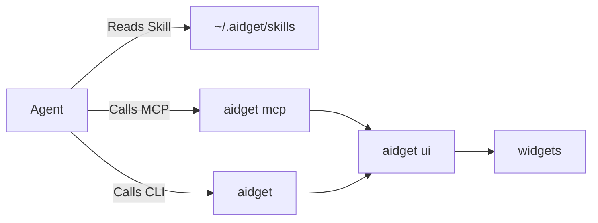

# Development workflow

## Requirements

- Rust 1.92 or newer
- Node.js 22.18+ (22.x) or 24.11+ (24.x); CI uses Node.js 24
- pnpm 12
- The platform WebView and packaging dependencies described in the README

## Architecture



The GUI owns widget windows and display APIs. CLI widget reads and writes can
run offline through the filesystem; MCP forwards requests to the resident GUI.
See `AGENTS.md` for module boundaries and the cross-layer command contract.

## Agent integrations

MCP and Skill use the fixed name `aidget` and can be installed independently.
Install replaces that entry; uninstall removes it without restoring an older
configuration. All skips unreadable configurations. Startup refreshes the Skill
source and the instance's CLI entry, leaving Agent entries untouched.

MCP, child GUIs and autostart use an absolute `--home`. The page omits the
argument for the OS default directory. MCP and Skill CLI commands use the fixed
entry under that directory: `aidget.exe` on Windows, `aidget` on macOS/Linux.
Windows startup copies the running executable there; macOS/Linux publish a
symlink. Skills use MCP only when it identifies their bound directory; copied
Skills need reinstalling to refresh, while links read source changes.

MCP writes preserve neighbors and back up the original file under
`<root>/state/agent-backups/`. Skill installation replaces the whole Agent
`skills/aidget` entry without a backup. Removing a link preserves its target;
the source and directories containing it cannot be removed or replaced.

## Interfaces

| MCP tool             | Purpose                                                                                                      |
| -------------------- | ------------------------------------------------------------------------------------------------------------ |
| `aidget_list`        | List widgets, revisions, board revision, positions, broken entries, compatibility and diagnostics summaries. |
| `aidget_get`         | Read one widget's metadata, HTML, CSS, `agents.md`, compatibility and current position.                      |
| `aidget_create`      | Create a widget with HTML, CSS, permissions, the minimum host version and author guidance.                   |
| `aidget_update`      | Replace files or metadata using revision compare-and-swap.                                                   |
| `aidget_patch`       | Atomically replace the inner HTML of one or more `data-aidget-region` targets.                               |
| `aidget_move`        | Move or resize with board revision CAS when the user asks.                                                   |
| `aidget_screenshot`  | Capture the rendered widget as PNG and wait briefly for readiness.                                           |
| `aidget_diagnostics` | Read session-scoped widget runtime errors without starting the GUI.                                          |
| `aidget_delete`      | Move a widget to the trash.                                                                                  |
| `aidget_guide`       | Read the complete Markdown authoring guide.                                                                  |

```text
aidget [--home DIR] [--json] <command> [options]
aidget ui [--background]
aidget mcp
aidget widget list|show|create|update|patch|delete|diagnostics
aidget board show|move
aidget displays
aidget screenshot <id> [--scale N] [--out FILE]
aidget doctor
aidget guide
aidget community list --json
aidget community install @aidget-community/<id> --json
```

## Contributor approval automation

`main` only accepts direct pushes from the repository owner and the
`aidget-bot` GitHub App. The App is installed only on this
repository with Contents write access. The approval workflow uses the
`AIDGET_BOT_CLIENT_ID` and `AIDGET_BOT_APP_ID` repository variables plus the
`AIDGET_BOT_PRIVATE_KEY` Actions secret to mint a short-lived installation token.

## Local checks

Run the checks that cover the change:

```bash
pnpm install --frozen-lockfile
pnpm check
pnpm test
pnpm typegen --check
cargo fmt --check
AIDGET_CHECK_TARGET=1 cargo check --lib
cargo test
```

`pnpm check` runs Vite+ formatting, linting and type checks with automatic fixes.
CI runs `pnpm exec vp check` without fixes. Builds and tests use the Vite and
Vitest versions bundled with Vite+.

`pnpm dev` keeps development data and its IPC socket under `.aidget/` by default.
Override it with `pnpm dev --home <directory>`. This lets development and installed copies run
alongside each other with separate system-tray icons. On macOS, Cargo launches
the executable from a minimal `aidget-dev.app` beside the compiled binary so the
system can display its menu-bar icon.

Debug builds enforce `minHostVersion` by default. To test a widget that declares
a newer host version, pass `--allow-incompatible-widgets` to `ui`, a CLI
installation, or `mcp`. Release builds ignore the option. It skips only the
host-version check; malformed configuration, platform and permission checks
still apply.

Debug builds disable their `aidget-dev` autostart entry on GUI startup and keep
the setting unavailable. Release builds use `aidget` and refresh an enabled entry
with the current executable and absolute `--home`, preserving disabled autostart.

`widgets/registry.json` is a filtered reviewed snapshot containing entries for
the packages actually bundled under `widgets/`; it is not a copy of the full
community catalogue. The running app fetches its catalogue from the community
repository's main branch. To update a bundled widget, bump its community package
version, regenerate the community registry, then copy the package and its
matching registry entry here together.

Verify that copied snapshot with:

```bash
pnpm exec vp test run tests/scripts/widgets/builtin.test.mjs
```

The cross-target library check compiles platform-gated Rust paths without the
platform bundler. It is not a runtime test.

Run runtime checks against a throwaway data directory:

```bash
cargo run -- --home /tmp/aidget-dev ui --background
cargo run -- --home /tmp/aidget-dev doctor
```

When running under Codex Desktop's macOS Seatbelt sandbox, launching
`pnpm dev` or a GUI build directly is unsupported: Seatbelt denies LaunchServices
and WindowServer access, and AppKit aborts at `_RegisterApplication` before
Tauri or application code starts. Run GUI development outside that sandbox.

Never use a real Agent configuration or `~/.aidget` as test data.

## Version model

The checked-in version files describe development builds:

- `Cargo.toml`
- `package.json`
- `tauri.conf.json`

Release artifacts do not commit a version bump. The release workflow checks out
the reviewed tag and runs `scripts/release/version.mjs set vX.Y.Z`, which updates
those manifests only in the workflow workspace before compiling, testing and
bundling.

This means a `vX.Y.Z` release reports `X.Y.Z` from the CLI, doctor, MCP server,
main window and bundle, while ordinary source builds keep the checked-in
development version.

## CI

The `check` workflow runs on `main` pushes, pull requests, and from the
Release workflow. A successful main push Check triggers Auto tag, which creates
the next stable patch tag on that checked commit if it is still main HEAD and
does not already carry a release tag.

The `release` workflow also performs real Tauri packaging on all six release
targets. A new validated release cancels lower-version releases still running;
see [releasing.md](releasing.md) for version allocation and cancellation rules.
